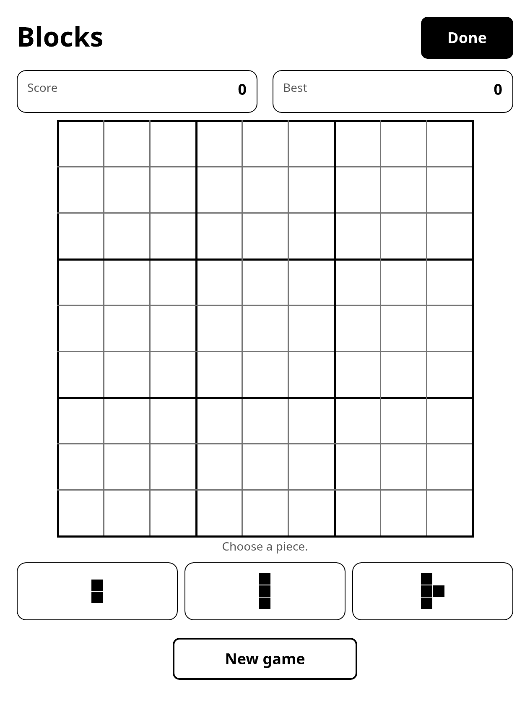
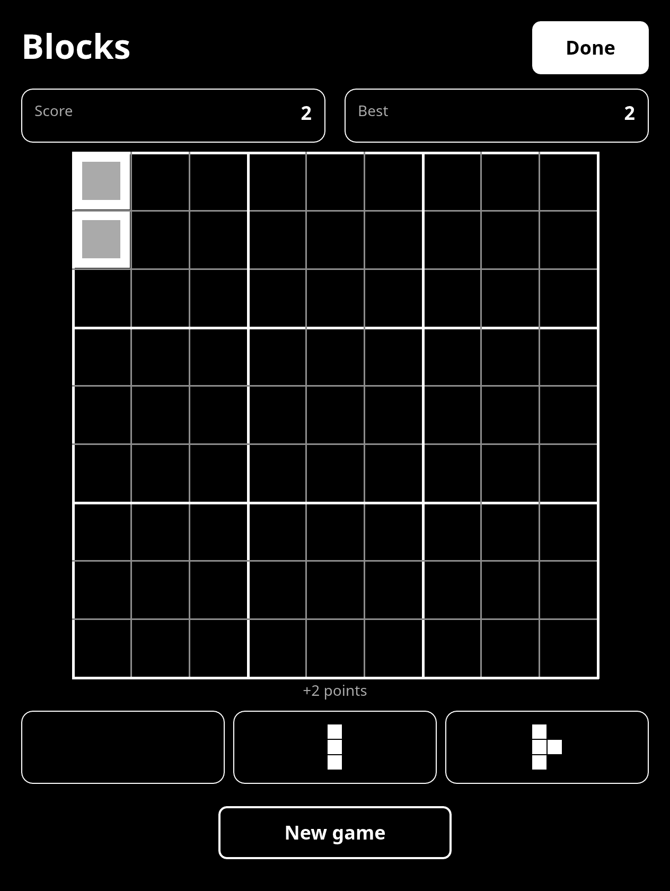
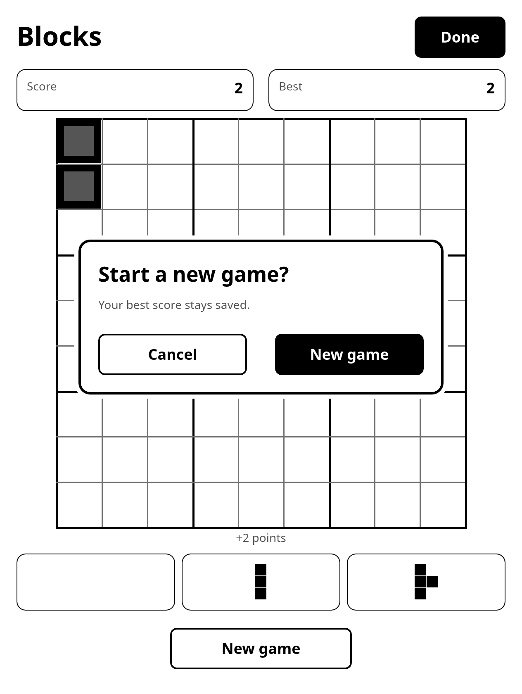

<div align="center">

# Primitive Blocks

**Fit three pieces at a time on a nine-by-nine board.**

[**Install guide**](INSTALL.md) · [**Device notes**](docs/device-notes.md) · [**Changelog**](CHANGELOG.md)

</div>

---

Choose one of the three offered pieces and tap where its upper-left corner should land. Completed rows, columns, and three-by-three boxes clear together. A fresh set appears after you place all three pieces.

## Screenshots

<table>
<tr>
<td align="center"><br><sub>Choose an opening piece</sub></td>
<td align="center"><br><sub>Continue a game in dark mode</sub></td>
<td align="center"><br><sub>Confirm before starting a new game</sub></td>
</tr>
</table>

<sub>Mac simulation captures at 1264 × 1680 pixels.</sub>

## Highlights

- **Place pieces.** Choose an offered piece and tap a position on the board.
- **Clear several lines at once.** A single placement can complete a row, column, and box.
- **Resume a game.** Blocks saves the current board and your best score.

## Quick start

1. Find the local ARMHF package and USB installation steps in the [install guide](INSTALL.md).
2. Extract the package, copy the `blocks` and `documents` folders to your jailbroken Kindle’s user storage, and eject it.
3. Open Primitive Blocks from Primitive Launcher. **Done** returns to the launcher grid.

The local `app.json` is a listing draft. A public listing requires approved artwork and an asset from a published release.

## Develop locally

Keep `doannt-kindle-tools` and `doannt-kindle-launcher` beside this checkout, then run the following from this repo.

```sh
cargo test --offline --locked --workspace
cargo run --offline --locked -p blocks-desktop
```

The desktop target writes previews to `build/previews/`. The desktop simulation exercises placement and the new-game confirmation. Physical Kindle testing is pending. See the [device notes](docs/device-notes.md) for the verification checklist.

## Licence

Copyright (C) 2026 Doan Nguyen.

Code is licensed under [PolyForm Noncommercial 1.0.0](LICENSE). The original documentation and pictures are licensed under [CC BY-NC-SA 4.0](LICENSE-DOCS).
